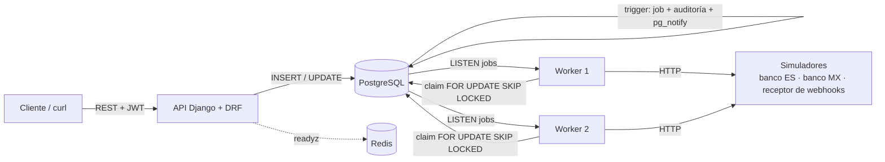
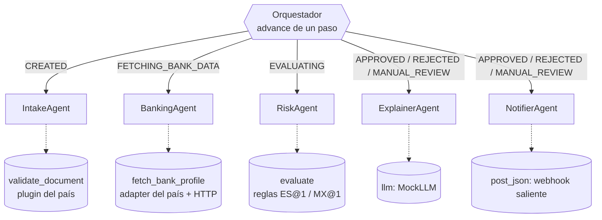
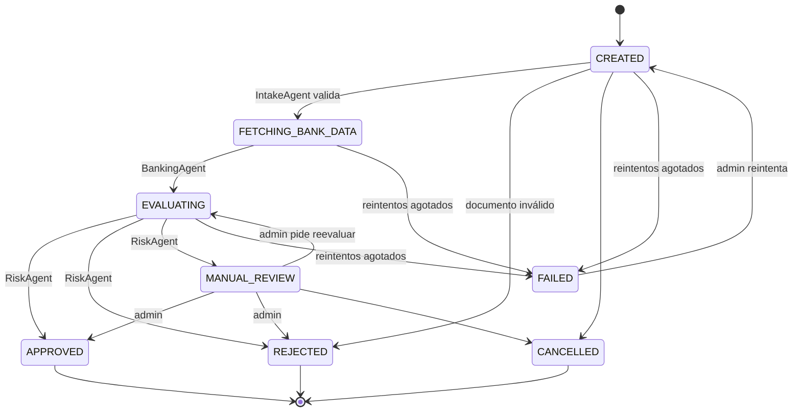
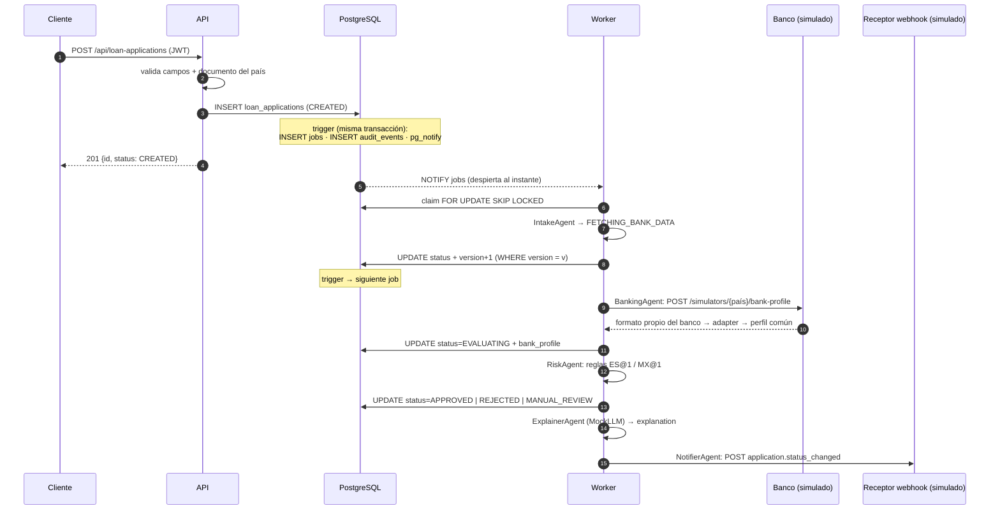

# Bravo — Originación de crédito multipaís (MVP)

Backend de un sistema de originación de crédito **multipaís** y **multi-agente**: recibe solicitudes, valida el documento de cada país, consulta al proveedor bancario del país, decide con reglas versionadas y notifica el resultado. Todo el procesamiento ocurre **en segundo plano y en paralelo**, disparado por un **trigger de PostgreSQL**.

Países implementados: **España (ES)** y **México (MX)**.

> **Estado:** el backend está completo y probado (72 tests). **No llegué a hacer** el frontend, el tiempo real, la caché ni los manifiestos de Kubernetes. Abajo se explica qué quedó fuera y por qué ([§13](#13-qué-quedó-fuera-y-por-qué)).

---

## Índice

1. [Ejecución en menos de 5 minutos](#1-ejecución-en-menos-de-5-minutos)
2. [Prueba rápida con `curl`](#2-prueba-rápida-con-curl)
3. [Supuestos](#3-supuestos)
4. [Arquitectura](#4-arquitectura)
5. [Respuestas de la sección 3 del enunciado](#5-respuestas-de-la-sección-3-del-enunciado)
6. [Reglas por país](#6-reglas-por-país)
7. [API](#7-api)
8. [Modelo de datos](#8-modelo-de-datos)
9. [Decisiones técnicas](#9-decisiones-técnicas)
10. [Seguridad](#10-seguridad)
11. [Concurrencia y escalabilidad](#11-concurrencia-y-escalabilidad)
12. [Observabilidad](#12-observabilidad)
13. [Qué quedó fuera y por qué](#13-qué-quedó-fuera-y-por-qué)
14. [Cómo añadir un país](#14-cómo-añadir-un-país)
15. [Estructura del repositorio](#15-estructura-del-repositorio)

---

## 1. Ejecución en menos de 5 minutos

**Requisitos:** Docker (con Compose v2) y `make`. No hace falta Python local ni credenciales externas.

```bash
make run
```

Levanta PostgreSQL, Redis, la API y **2 workers**, aplica las migraciones y crea los usuarios demo. Medido desde cero: **~15 s** con las imágenes ya descargadas (1–3 min la primera vez).

| Servicio | URL |
|---|---|
| API | http://localhost:8000 |
| Salud | `GET /healthz` (vivo) · `GET /readyz` (Postgres + Redis) |
| PostgreSQL | `localhost:5433` (usuario `bravo_user`, BD `bravodb`) |

**Usuarios demo** (contraseña `bravo-demo`, solo para desarrollo):

| Usuario | Rol | Países |
|---|---|---|
| `analyst_es` | analyst | ES |
| `analyst_mx` | analyst | MX |
| `admin` | admin | ES, MX |

**Otros comandos** (`make` a secas los lista):

| Comando | Qué hace |
|---|---|
| `make test` | Ejecuta los tests (pytest, dentro de Docker) |
| `make lint` / `make format` | Revisa / corrige el estilo (ruff) |
| `make migrate` · `make seed` | Migraciones · usuarios demo (se puede repetir) |
| `make logs` · `make shell` · `make down` | Logs · shell de Django · parar (conserva los datos) |

> Todas las variables de entorno de desarrollo están en `docker-compose.yml`, con valores **solo de desarrollo** (`dev-only-not-secret…`). En producción vendrían de un gestor de secretos. No hay ningún `.env` ni credencial real en el repositorio.

---

## 2. Prueba rápida con `curl`

```bash
# 1. Login
TOKEN=$(curl -s -X POST localhost:8000/api/auth/token -H 'Content-Type: application/json' \
  -d '{"username":"analyst_es","password":"bravo-demo"}' | python3 -c 'import json,sys;print(json.load(sys.stdin)["access"])')

# 2. Crear una solicitud (responde 201 al momento, con status CREATED)
curl -s -X POST localhost:8000/api/loan-applications -H "Authorization: Bearer $TOKEN" \
  -H 'Content-Type: application/json' \
  -d '{"country":"ES","amount":"25000","monthly_income":"3000","full_name":"Ana Pérez","document":"12345678Z"}'

# 3. Un segundo después ya está decidida (25.000 € > 20.000 € → MANUAL_REVIEW)
curl -s localhost:8000/api/loan-applications/<id> -H "Authorization: Bearer $TOKEN"
```

Respuesta del detalle para un analista (PII enmascarada):

```json
{
  "status": "MANUAL_REVIEW", "version": 4, "currency": "EUR",
  "full_name": "A. P.", "document": "****5678Z",
  "explanation": "[simulated LLM] The ES application of 25000.00 with a monthly income of 3000.00 needs a manual review by the country rules."
}
```

Documentos válidos de ejemplo: **ES** `12345678Z`, `X1234567L` (NIE) · **MX** `HEGG560427MVZRRL04` (ejemplo oficial de RENAPO).

---

## 3. Supuestos

- **Dos países**, ES y MX. El resto se añade con un plugin, sin tocar el núcleo ([§14](#14-cómo-añadir-un-país)).
- **Los proveedores bancarios están simulados** dentro de la propia API (`/simulators/…`, activos solo con `SIMULATORS_ENABLED=true`). Son **deterministas**: el mismo documento da siempre la misma respuesta, así que las demos y los tests se pueden repetir.
- **Los dos proveedores tienen formatos distintos**, como pide el enunciado:
  - **ES** responde con un JSON plano en euros: `{"cuota_mensual_deudas": "1176.96", "moneda": "EUR"}`.
  - **MX** responde con datos anidados y montos en centavos: `{"cliente": {"pagos_mensuales_centavos": 1336781}, "divisa": "MXN"}`.
  - Cada adapter los traduce al **perfil común** `{"monthly_debt_payments": "…"}`.
- **El proveedor MX es síncrono.** Un proveedor asíncrono con callback era opcional y quedó fuera ([§13](#13-qué-quedó-fuera-y-por-qué)).
- **La validación de documentos** comprueba el formato y el dígito o letra de control (DNI/NIE: módulo 23; CURP: regex y dígito verificador de RENAPO). **No** comprueba que el documento exista ni que pertenezca a esa persona: eso requeriría un servicio oficial.
- **Una sola solicitud activa por documento y país.** Una segunda devuelve `409`. Las cerradas (aprobadas, rechazadas o canceladas) no bloquean una nueva.
- **La moneda la fija el país** (ES → EUR, MX → MXN), no el cliente.
- **El dinero** se guarda como `numeric(18,2)` (nunca `float`), y **las fechas** en UTC.
- **El LLM está simulado** (`MockLLM`): el proyecto se ejecuta sin credenciales externas.

---

## 4. Arquitectura

### 4.1 Componentes



| Servicio | Qué es | Escala |
|---|---|---|
| `api` | Django 5.2 + DRF sobre uvicorn (ASGI) | Horizontal, sin estado |
| `worker` ×2 | `python manage.py run_worker`: consume la cola y ejecuta el orquestador | Horizontal; las réplicas se reparten los jobs |
| `postgres` | Datos, **cola de jobs** y auditoría | Vertical + réplicas de lectura |
| `redis` | Arrancado, pero sin uso todavía (la caché quedó fuera, [§13](#13-qué-quedó-fuera-y-por-qué)) | — |

### 4.2 Arquitectura agéntica



Los **cuatro primitivos** del enunciado:

| Primitivo | Dónde está |
|---|---|
| **Agentes** | `backend/agents/`. Cada uno tiene un `name`, una **política de campos** (`fields`) y `run(context) → AgentResult`. **No acceden a la BD**: reciben un `AgentContext` con solo sus campos y devuelven un resultado que el orquestador guarda. |
| **Herramientas** | Las inyecta el **plugin del país** (`validate_document`, `fetch_bank_profile`, `evaluate`) más las comunes de `backend/tools/` (`llm`, `http`). La variación por país está en las herramientas, no en los agentes: un país nuevo no crea agentes nuevos. |
| **Estado y memoria** | **Corto plazo:** la fila de `loan_applications`, versionada (bloqueo optimista). **Largo plazo:** `audit_events`, *append-only*, que guarda cada transición con su agente y su motivo. Los agentes no tienen estado oculto: su "memoria" es lo que les pasa el orquestador. |
| **Flujos y orquestación** | Máquina de estados (`apps/loans/states.py`) + `orchestrator.advance(job)`. Cada cambio de estado confirmado dispara, vía trigger, el job del paso siguiente: un flujo **dirigido por eventos de la BD** y reanudable desde cualquier punto. |

### 4.3 Máquina de estados



Las transiciones **manuales** (`PATCH /status`) pasan por la **misma validación** que las automáticas: ni un admin puede saltarse el flujo.

### 4.4 Flujo de una solicitud



Medido en local: de la respuesta `201` a la decisión final, **~70 ms**.

---

## 5. Respuestas de la sección 3 del enunciado

### ¿Qué responsabilidades asignaste a cada agente y por qué ese reparto?

| Agente | Responsabilidad | Decide |
|---|---|---|
| **Orquestador** | Lee el estado, elige el agente de ese estado, guarda su resultado y la transición **en una transacción** con control de versión. No contiene reglas de negocio de ningún país. | Solo el siguiente paso |
| **IntakeAgent** | Revalida el documento con el plugin del país. La API ya valida lo que entra por ella; el agente protege el flujo frente a datos que lleguen por otro canal o que se crearan antes de endurecer un validador. | Rechazo por documento inválido |
| **BankingAgent** | Pide al proveedor del país la información bancaria y la guarda en el **perfil común**. | — |
| **RiskAgent** | Aplica las reglas del país en su versión vigente. | **Sí**: APPROVED / REJECTED / MANUAL_REVIEW |
| **ExplainerAgent** | Redacta un resumen legible para el analista (LLM simulado). | No |
| **NotifierAgent** | Envía el webhook `application.status_changed` al sistema externo. | No |

**Por qué este reparto:** cada agente corresponde a un paso con **fallo y reintento independientes**. Validar, llamar a un tercero, decidir y notificar fallan por motivos distintos. Si el banco cae, solo se reintenta el paso del banco; la validación ya hecha no se repite. Y la variación por país está en las **herramientas** (el plugin), no en los agentes.

### ¿Qué parte del sistema usa un LLM y cuál no? ¿Cómo garantizas que una decisión sea reproducible y auditable?

- **Solo el ExplainerAgent usa un LLM**, simulado con `MockLLM` (determinista y sin credenciales). Su texto es **informativo**: se guarda aparte (`explanation`) y **nunca** cambia la decisión.
- **La decisión de crédito no usa LLM.** La toma el RiskAgent con reglas **puras y versionadas** (`ES@1`, `MX@1`): sin BD, sin reloj, sin azar. Mismas entradas + misma versión = misma decisión.
- **Auditable:** cada transición queda en `audit_events` (*append-only*: un trigger rechaza `UPDATE` y `DELETE`) con el estado de origen y destino, la versión, **el agente que la hizo**, **el motivo con la versión de reglas** (p. ej. `ES@1: amount above 20000 EUR`), el actor si fue una persona y el `correlation_id` de la petición original.
- **Reproducible:** las entradas de la decisión (monto, ingreso y `bank_profile`) se conservan en la solicitud, así que se puede recalcular con la misma versión. Un comando `replay` que lo verifique automáticamente quedó como evolución ([§13](#13-qué-quedó-fuera-y-por-qué)).

### ¿Qué información ve cada agente y cómo proteges la PII?

Cada agente declara su **política de campos**. `AgentContext` copia **solo** esos campos de la solicitud; los demás ni siquiera se leen, y pedir otro lanza `FieldNotAllowedError`.

| Agente | Nombre | Documento | Monto / ingreso | Perfil bancario | Ids / estado |
|---|:-:|:-:|:-:|:-:|:-:|
| Intake | ✘ | ✔ | ✘ | ✘ | país |
| Banking | ✘ | ✔ (solo para consultar al banco) | ✘ | ✘ | país |
| Risk | ✘ | ✘ | ✔ | ✔ | país |
| Explainer | ✘ | ✘ | ✔ | ✘ | país, estado |
| Notifier | ✘ | ✘ | ✘ | ✘ | id, país, estado, versión |

**Ni el RiskAgent ni el LLM ven quién es el solicitante.** Así la decisión no puede depender de eso, y un LLM real no podría filtrar lo que nunca recibió.

Resto de medidas, en [§10 Seguridad](#10-seguridad): enmascarado según rol, alcance por país, redacción en logs, notificaciones sin PII y payload bancario crudo nunca guardado.

### ¿Cómo se recupera el sistema si un agente, una herramienta o un proveedor falla a mitad del flujo?

Cada paso es un **job independiente** en la cola, así que un fallo afecta solo a ese paso:

1. **Timeout** de 5 s en cada llamada HTTP (banco y webhook).
2. **Reintentos automáticos** con backoff exponencial y *jitter* (2, 4, 8, 16 s…, máx. 5 min).
3. **Si un worker muere a mitad**, no pierde el trabajo: tenía el job **alquilado** (*lease* de 60 s). Al vencer, cualquier otro worker lo reclama, sin un proceso vigilante aparte. Un job que tumba al worker una y otra vez (*poison job*) acaba en `dead` al agotar sus intentos.
4. **Al agotar los intentos**, el job pasa a `dead` y **la solicitud a `FAILED`**. El error queda en la auditoría (con el agente que falló) y en `jobs.last_error`.
5. **Un admin la reintenta** cuando el proveedor vuelve (`PATCH /status` con `to: CREATED`) y el flujo empieza de nuevo.
6. **Reintentar es seguro:**
   - Cada cambio de estado lleva **control de versión**; si otro worker ya avanzó la solicitud, el cambio se descarta.
   - Un job viejo (de una versión anterior) se ignora.
   - El `dedupe_key` (`<id>:<versión>`) impide encolar dos veces el mismo paso.
7. **Si solo falla la notificación**, la decisión **se mantiene**: la máquina de estados no permite pasar de una decisión a `FAILED`. Solo se reintenta el envío.

Probado de punta a punta: con el banco caído, la solicitud llegó a `FAILED` tras 5 intentos; al volver el banco, el admin la reintentó y terminó en `APPROVED`.

---

## 6. Reglas por país

Las del enunciado, como mínimo, con estos umbrales:

| País | Documento | Regla | Resultado |
|---|---|---|---|
| **ES** (`ES@1`, EUR) | DNI / NIE | monto **> 20.000 €** | `MANUAL_REVIEW` (si no, `APPROVED`) |
| **MX** (`MX@1`, MXN) | CURP | monto **> 12 ×** ingreso mensual | `REJECTED` (si no, `APPROVED`) |
| Ambos | — | documento inválido (IntakeAgent) | `REJECTED` |

Código: `backend/countries/{es,mx}/rules.py`. Más reglas posibles, en [§13](#13-qué-quedó-fuera-y-por-qué).

---

## 7. API

Errores con **formato uniforme** en toda la API: `{"code", "message", "details", "correlation_id"}`.

| Método | Ruta | Quién | Notas |
|---|---|---|---|
| POST | `/api/auth/token` · `/api/auth/refresh` | público | JWT: access de 15 min, refresh de 1 día con rotación y lista negra |
| POST | `/api/loan-applications` | analyst, admin (de ese país) | `201` · documento inválido → `400` en `details.document` · duplicada activa → `409` |
| GET | `/api/loan-applications?country=&status=&page_size=&cursor=` | analyst, admin | Solo los países del usuario. Paginación **por cursor** |
| GET | `/api/loan-applications/{id}` | analyst (enmascarado), admin (completo, **se audita**) | Otro país → `404`, no `403` (no revela que existe) |
| PATCH | `/api/loan-applications/{id}/status` `{to, reason, expected_version}` | admin | Versión vieja → `409`. Transición ilegal → `400`. También sirve para reintentar una `FAILED` |
| GET | `/healthz` · `/readyz` | público | Vida · disponibilidad (Postgres + Redis) |

---

## 8. Modelo de datos

| Tabla | Para qué | Columnas clave |
|---|---|---|
| `loan_applications` | Solicitud y estado actual | `id` **UUIDv7**, `country`, `status`, `version`, `amount` / `monthly_income` `numeric(18,2)`, `currency`, `full_name`, `document` (normalizado), `bank_profile jsonb` (perfil común), `explanation`, `created_by_id`, `created_at` (fecha de solicitud), `updated_at` |
| `jobs` | **La cola** | `kind`, `application_id`, `status` (pending / running / done / dead), `attempts` / `max_attempts`, `run_at`, `locked_by` / `locked_until` (*lease*), `last_error`, `dedupe_key`, `correlation_id`. Valores por defecto **en la BD** (`db_default`), porque los inserta un trigger |
| `audit_events` | Historial *append-only* | `application_id`, `actor_id`, `event` (`status_changed`, `pii_access`), `data jsonb` (from, to, version, reason, agent), `correlation_id`. **Sin claves foráneas**: sobrevive a lo que describe |
| `accounts_user` | Usuarios | `role` (analyst / admin), `allowed_countries varchar(2)[]` |

**Por qué UUIDv7:** no se puede adivinar (frente a 1, 2, 3…), y como empieza por la hora, las inserciones van al final del índice en vez de fragmentarlo (frente a un UUID aleatorio). Además deja la tabla preparada para particionar por fecha.

**El trigger** (`apps/loans/migrations/0004` y `0006`): en cada `INSERT` o cambio de `status` de `loan_applications`, **en la misma transacción**, inserta el job (`ON CONFLICT (dedupe_key) DO NOTHING`), la fila de auditoría y los avisos `pg_notify('jobs')` y `pg_notify('application_events')` (este último sin PII, preparado para el tiempo real). Es un **outbox transaccional**: o se guarda todo o nada, sin *dual write*.

---

## 9. Decisiones técnicas

| Tema | Decisión | Alternativa descartada | Por qué |
|---|---|---|---|
| Lenguaje / framework | Python 3.14 + Django 5.2 LTS + DRF | FastAPI | ORM, migraciones y autenticación incluidos; versión LTS |
| Cola | **PostgreSQL** (trigger + `FOR UPDATE SKIP LOCKED` + `LISTEN/NOTIFY`) | Celery + RabbitMQ / Redis | El enunciado pide capacidades nativas de la BD; una pieza menos; el job y el cambio de estado son atómicos |
| Orquestación | Orquestador propio, un paso por job | LangGraph, Temporal | Los cuatro primitivos quedan explícitos y auditables, sin dependencias pesadas |
| Concurrencia | Bloqueo **optimista** (`version`) | Bloqueos pesimistas | Nadie bloquea filas mientras mira; los conflictos se detectan al escribir |
| Países | **Plugins** (`countries/<código>/`) + registro con `ENABLED_COUNTRIES` | `if country == …` en el núcleo | Añadir un país no toca el núcleo |
| Decisión | Reglas puras y versionadas | LLM | Reproducible y auditable |
| Webhook | **Saliente** (al decidir) | Entrante | El enunciado pide uno de los dos; el saliente se integra sin estados extra |
| HTTP saliente | `urllib` (librería estándar) | `requests` / `httpx` | Sin dependencias nuevas para tres llamadas simples |
| Dependencias | `pip` + `requirements*.txt` con versiones exactas | Poetry, uv | Nada extra que instalar; builds reproducibles |
| Configuración | Variables de entorno (django-environ), sin `.env` | `.env` en el repo | Nada sensible en git; los secretos no tienen valor por defecto |
| Tareas | `Makefile` | `just` | `make` ya está instalado en casi cualquier máquina |

---

## 10. Seguridad

- **Autenticación:** JWT (SimpleJWT). Access de 15 min; refresh de 1 día **rotativo con lista negra** (un refresh usado no vale una segunda vez); clave de firma propia (`JWT_SIGNING_KEY`), separada de `SECRET_KEY`.
- **Autorización:** **toda la API exige autenticación por defecto**. Además:
  - **Rol:** solo `admin` cambia estados o ve PII completa.
  - **País:** cada usuario solo ve y crea solicitudes de sus `allowed_countries`. Las de otro país devuelven `404`, no `403`, para no revelar que existen.
- **PII:**
  - **En la API:** el analista ve el documento como `****5678Z` y el nombre como iniciales. El listado enmascara **siempre**, también para el admin. El detalle completo solo lo ve el admin, y cada acceso queda en `audit_events` (`pii_access`).
  - **En los agentes:** cada uno ve solo sus campos ([§5](#qué-información-ve-cada-agente-y-cómo-proteges-la-pii)).
  - **En los logs:** un *processor* de structlog redacta las claves sensibles (`document`, `full_name`, `password`, `token`…) y cualquier DNI, NIE o CURP que aparezca en un texto.
  - **En los errores:** los mensajes nunca repiten el documento.
- **Datos bancarios:** solo se guarda el **perfil común** (la cuota mensual de deudas). El payload crudo del banco **no se guarda** y no se expone.
- **Hacia fuera:** las notificaciones (`pg_notify` y el webhook) solo llevan **ids y estado**.
- **Errores:** nunca devuelven detalles internos. Un 500 solo dice `Internal server error.`, y el *traceback* va al log.
- **Secretos:** se leen de variables de entorno, sin valor por defecto en el código. Los de `docker-compose.yml` son explícitamente de desarrollo.
- **Simuladores:** sus rutas **no existen** salvo con `SIMULATORS_ENABLED=true`.
- **No implementado:** el cifrado a nivel de campo de la PII en la BD ([§13](#13-qué-quedó-fuera-y-por-qué)).

---

## 11. Concurrencia y escalabilidad

### Varios workers sin inconsistencias

| Riesgo | Mecanismo |
|---|---|
| Dos workers toman el mismo job | `SELECT … FOR UPDATE SKIP LOCKED` (probado con 2 hilos reales; sin `FOR UPDATE`, el test falla) |
| Dos procesos cambian la misma solicitud | `UPDATE … WHERE id = ? AND version = ?`; si no afecta a ninguna fila → conflicto (`409` en la API; el job se descarta) |
| El mismo paso se encola dos veces | `dedupe_key` único (`<id>:<versión>`) |
| Un job queda obsoleto (la solicitud cambió después) | El orquestador compara la versión del job con la actual y lo ignora |
| Dos solicitudes activas del mismo documento | Índice único **parcial** `(country, document) WHERE status NOT IN ('APPROVED','REJECTED','CANCELLED')`. Lo garantiza Postgres, también ante peticiones simultáneas |
| Un worker muere con un job | El *lease* vence y otro lo reclama |

### Índices y consultas críticas

| Consulta | Índice |
|---|---|
| Listado por país y estado, más recientes primero | `(country, status, created_at DESC, id DESC)` |
| Listado por país, más recientes primero | `(country, created_at DESC, id DESC)` |
| Buscar por documento | `(country, document)` |
| Una sola solicitud activa por documento | único parcial (ver arriba) |
| Workers: jobs listos | **parcial** `(queue, run_at) WHERE status = 'pending'`: solo indexa lo pendiente, así que no crece con el histórico |
| Workers: *leases* vencidos | **parcial** `(locked_until) WHERE status = 'running'` |
| Historial de una solicitud | `audit_events (application_id, created_at)` |

- **Paginación por cursor**, nunca `OFFSET`: las páginas profundas son igual de rápidas y nada se repite ni se salta si llegan filas nuevas (probado con 5 filas con la misma fecha exacta).
- **Sin índices de sobra:** en `jobs`, la unicidad se declara como `UniqueConstraint` para evitar el índice `LIKE` extra que añadiría Django; cada índice de más encarece cada inserción en la cola.

### Cómo escalaría a millones de solicitudes

- **API y workers** no tienen estado: escalan en horizontal. Los workers se reparten la cola solos (más réplicas = más rendimiento, hasta saturar la BD).
- **Colas separadas:** la columna `queue` permite grupos de workers dedicados, por ejemplo para aislar un proveedor lento de un país.
- **Límite de la cola en Postgres:** miles de jobs por segundo con índices parciales. Si no bastara, se cambia el **transporte** (por ejemplo, el outbox reenviado a Kafka o RabbitMQ) sin tocar los agentes: solo dependen de `JobQueue`.
- **Lecturas:** réplicas de lectura para los listados.

### Archivado (explicado, no implementado)

- **Purgado de la cola:** un job periódico, que se reprograma solo y no necesita *scheduler*, borraría por lotes los `jobs` en `done` de más de 7 días. El diseño completo está en `arch.md` §6.2.1. Es lo **primero** que haría falta con volumen real.
- **Particionado mensual** por `created_at` de `loan_applications` y `audit_events` (con `pg_partman`). El UUIDv7 ya ordena por tiempo. El índice único parcial pasaría a una tabla auxiliar `active_loan_applications (country, document)`, porque en una tabla particionada todo índice único debe incluir la clave de partición.
- **Almacenamiento frío:** las solicitudes cerradas antiguas se exportarían (por ejemplo, a Parquet) y se borrarían por lotes. `audit_events` se conserva todo el plazo legal.

---

## 12. Observabilidad

- **Logs estructurados en JSON** (structlog), una línea por evento, tanto los nuestros como los de Django.
- **`correlation_id`** en cada petición (cabecera `X-Correlation-ID`, que se reutiliza si llega y se devuelve en la respuesta). **Viaja con el trabajo:** petición HTTP → job → logs del worker → auditoría. Una solicitud se sigue de punta a punta con un solo id.
- **`audit_events`:** cada transición con su agente, motivo, versión, actor y `correlation_id`. Reconstruye cualquier flujo asíncrono:

  ```
  —                  → CREATED             (creación)
  CREATED            → FETCHING_BANK_DATA  intake
  FETCHING_BANK_DATA → FAILED              banking  "URLError(…)"
  FAILED             → CREATED             admin    "el banco volvió"
  …                  → APPROVED            risk     "ES@1: all rules passed"
  ```

- **Fallos:** `jobs.last_error` + el log `job_failed` (con *traceback*, `job_id`, `application_id` y `correlation_id`).

---

## 13. Qué quedó fuera y por qué

El enunciado da de 1 a 3 días y valora **priorizar** más que acumular funcionalidades. Mi criterio fue **construir el núcleo del backend completo, probado y con lo mínimo que exige cada requisito**, y documentar el resto en vez de dejarlo a medias. El diseño de casi todo lo que falta ya está en `arch.md`.

### Exigido por el enunciado y no implementado (por falta de tiempo)

| Qué | Por qué falta | Cómo se haría |
|---|---|---|
| **Frontend** (crear, listar, ver detalle, cambiar estado, errores visibles) | Prioricé que el backend estuviera completo y probado: sin él, el frontend no tendría nada que mostrar | React + Vite + TS con TanStack Query, contra la API actual (los endpoints y el formato de errores ya están pensados para él) |
| **Tiempo casi real** | Depende del frontend | **El trigger ya publica** `pg_notify('application_events', {id, country, status, version})` sin PII. Faltan una vista SSE async en Django con un único `LISTEN` por proceso, filtrada por `allowed_countries`, y un ticket SSE de un solo uso (el `EventSource` del navegador no envía cabeceras JWT) |
| **Caché** | Ningún flujo la necesita todavía para funcionar | **Qué:** la respuesta del proveedor bancario, en Redis (que ya está en Compose), con clave `bank:{país}:{versión_del_adapter}:{application_id}`. **Por qué:** es la llamada más lenta y externa, y los reintentos y reevaluaciones no deberían repetirla. **Invalidación:** TTL de 15 min, borrado explícito cuando un admin fuerza una reconsulta, y cambio de versión del adapter, que invalida todas las claves de golpe. **Si Redis cae:** se consulta al proveedor directamente (*fail-open*) |
| **Manifiestos de Kubernetes** | Por tiempo | Kustomize con `Deployment` de `api` (con `readinessProbe` en `/readyz` y `livenessProbe` en `/healthz`, ya implementados) y de `worker` (escalable con HPA), un `Job` de migraciones, `ConfigMap` + `Secret`, y overlays para local y producción |

### Recortado a propósito para quedarme en lo mínimo que pide el enunciado

| Qué | Por qué | Qué hace el MVP en su lugar |
|---|---|---|
| **Banco MX asíncrono** (202 + callback firmado), **webhook entrante**, estado `WAITING_BANK_CALLBACK` con timeout | El enunciado pide proveedores con **formatos distintos**, no asíncronos, y **un** webhook (entrante **o** saliente) | Banco MX síncrono con formato propio + webhook **saliente** |
| **Estados propios por país** (extensión de la máquina de estados) | Solo hacía falta para la espera del callback MX | Un único flujo común; un país podría declarar estados extra en su plugin |
| **Más reglas por país** (ES: > 50.000 € y esfuerzo > 40 % → rechazo; MX: ingreso < 8.000 MXN → rechazo, deuda/ingreso > 50 % → revisión) | El enunciado exige **una** regla por país | La regla mínima de cada país |
| **`decision_trace`, `input_hash` y comando `replay`** | La reproducibilidad ya se apoya en reglas puras + versión + entradas conservadas | Versión y motivo en la auditoría |
| **Cifrado de PII en la BD** (AES-GCM con *key id* + huella HMAC para buscar duplicados) | No lo pide el enunciado; el "manejo seguro de PII" se cubre con control de acceso | Enmascarado, alcance por país, redacción en logs y política de campos de los agentes |
| **Tabla `agent_runs`** (traza de cada ejecución de agente) | Duplicaba la auditoría | El agente queda en `audit_events`; los fallos, en `jobs.last_error` y los logs |
| **Jobs periódicos de purgado** | El enunciado pide **explicar** el archivado | Explicado en [§11](#archivado-explicado-no-implementado) |
| **Firma HMAC del webhook saliente** y tabla `webhook_deliveries` | No lo pide el enunciado; los reintentos ya los da la cola | `event_id` para que el receptor descarte duplicados |
| ***Circuit breaker*** por proveedor | Es un **extra opcional** del enunciado | Timeout + reintentos con backoff + `FAILED` + reintento manual |
| **LLM real** | El enunciado permite el modo simulado | `MockLLM`, intercambiable por un cliente real con el mismo método `complete()` |
| **Filtros de listado por fecha e importe** | El enunciado pide filtrar por país "y otros criterios relevantes" | País y estado |

### Limitaciones conocidas

- **Los workers no se recargan solos** al cambiar el código en desarrollo (la API sí). Hay que ejecutar `docker compose restart worker`.
- **La validación de documentos** comprueba el formato y el control, no que el documento exista.
- **`TRUNCATE` no está bloqueado** en `audit_events`: los tests lo usan. En producción se retiraría ese permiso al usuario de la aplicación, o las migraciones se ejecutarían con otro usuario.

---

## 14. Cómo añadir un país

Ejemplo: Colombia (CO).

1. Crear `backend/countries/co/` con:
   - `document.py`: `validate_document(value) → documento normalizado`, o lanza `InvalidDocumentError`.
   - `bank.py`: `fetch_bank_profile(document) → {"monthly_debt_payments": "…"}`, el adapter de su banco.
   - `rules.py`: `evaluate(amount, monthly_income, bank_profile) → (decisión, motivo)`, con su versión (`CO@1`).
   - `plugin.py`: `plugin = ColombiaPlugin()`, que une las tres piezas, más `code = "CO"` y `currency = "COP"`.
2. Añadir `CO` a `ENABLED_COUNTRIES`.

**No cambian** la API, el orquestador, los agentes ni las tablas. Si el plugin no cumple el contrato (`countries/base.py`), la aplicación **no arranca**, en vez de fallar en mitad de una solicitud.

---

## 15. Estructura del repositorio

```
bravo/
├── backend/
│   ├── config/          # settings (variables de entorno), urls, asgi
│   ├── apps/            # apps de Django
│   │   ├── accounts/    #   usuario (rol + países), JWT, permisos, seed_users
│   │   ├── loans/       #   solicitud, auditoría, máquina de estados, API, trigger (migraciones)
│   │   ├── orchestration/ # tabla jobs, JobQueue, Worker, orquestador, run_worker
│   │   └── simulators/  #   bancos ES/MX y receptor de webhooks (solo desarrollo)
│   ├── agents/          # Python puro: Agent, AgentContext y los 5 agentes
│   ├── countries/       # Python puro: contrato, registro y plugins ES / MX
│   ├── tools/           # herramientas comunes: llm (simulado), http
│   └── core/            # transversal: logs, correlation_id, errores, PII, auditoría, salud
├── docker-compose.yml
├── Makefile
├── mvp.md               # enunciado
├── arch.md              # documento de arquitectura (incluye el diseño de lo que quedó fuera)
└── plan.md              # plan de implementación paso a paso
```

Los tests viven junto al código (`<paquete>/tests/`) y no se copian a la imagen de producción.
